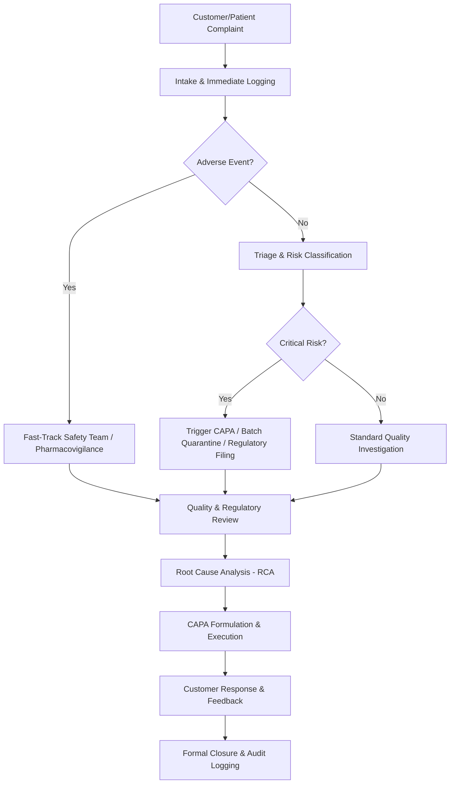

# Pharmaceutical Complaint Management Workflow & QMS Analysis

This document describes the regulatory framework (GMP, FDA 21 CFR Part 211.198) and standard operating procedures (SOPs) for handling customer complaints in a pharmaceutical environment.

## 1. Complaint Intake & Lifecycle Flowchart

---

## 2. Phase 1: Intake & Logging (What Happens Initially)

When a customer (patient, physician, pharmacist, or distributor) submits a complaint, it enters the pharmaceutical company’s Quality Management System (QMS) through channels like emails, physical letters, web forms, or product returns. 

### Key Timelines
* **Initial Logging**: Must be registered in the system within **24 hours** of receipt.
* **Adverse Event (AE) Triage**: If the complaint contains an AE (e.g., patient suffered injury, illness, or death), it must be reported to the Pharmacovigilance (PV) department within **24 hours** to comply with global regulatory guidelines (e.g., FDA MedWatch, EMA EudraVigilance).

---

## 3. Phase 2: Information Recorded (The Complaint File)

Under GMP regulations (21 CFR 211.198), every complaint must be documented in a written record. The following structured parameters are captured:

### Primary Complaint Metadata
* **Customer Info**: Name, contact details, company/pharmacy, geographical region.
* **Product Details**: Product name, dosage form, strength, pack size.
* **Batch/Lot Information**: Batch number, expiration date, manufacture date.
* **Complaint Type**:
  * *Critical/Safety*: Adverse drug reaction, contamination, wrong product inside package.
  * *Product Quality*: Discoloration, chipped tablets, leaking bottles, precipitate in solution.
  * *Packaging/Labelling*: Missing insert, incorrect expiry date print, damaged seal.
  * *Efficacy*: Lack of therapeutic effect.
* **Problem Description**: The raw text or image showing the defect.
* **Document Attachments**: Original email text, photos of defective product/packaging, PDF reports.

---

## 4. Phase 3: Investigation & Root Cause Analysis (RCA)

Once logged, the Quality Assurance (QA) team initiates an investigation to determine if the complaint represents a single event or a batch-wide systemic issue.

### Investigation Steps
1. **Sample Collection**: Requesting the customer return the physical complaint sample for laboratory evaluation.
2. **Retain Sample Analysis**: If the complaint sample is unavailable, QA tests the "retain sample" (samples stored from the original batch during manufacturing).
3. **Batch Record Review (BPR)**: Inspecting the original manufacturing logs, testing results, packaging records, environmental controls, and equipment calibration data for that batch.
4. **Root Cause Analysis (RCA) Tools**:
  * **5 Whys**: Asking "Why" sequentially to drill down to the fundamental process failure.
  * **Ishikawa (Fishbone) Diagram**: Mapping potential contributors across 6 categories (Man, Machine, Material, Method, Measurement, Mother Nature/Environment).
  * **FMEA (Failure Mode and Effects Analysis)**: Determining severity, occurrence, and detection ratings to compute a Risk Priority Number (RPN).

---

## 5. Phase 4: Corrective and Preventive Actions (CAPA)

The goal of CAPA is to fix the immediate issue and prevent its recurrence.

* **Corrective Action**: Addressing the immediate batch/defect (e.g., quarantining similar batches in the warehouse, executing a product recall, notifying regulatory agencies).
* **Preventive Action**: Systemic corrections to prevent reoccurrence (e.g., modifying standard operating procedures, upgrading machinery, installing camera-based inspection lines, retraining personnel).
* **Effectiveness Check**: Scheduling a follow-up review (e.g., in 6 months) to verify that the CAPA has indeed prevented the problem from reoccurring.

---

## 6. Phase 5: Closure & Audit Logs

A complaint can only be closed once:
1. The root cause has been identified (or justified if undetermined).
2. The immediate corrective actions are complete and preventive actions are scheduled/implemented.
3. A formal response letter is sent to the customer detailing findings.
4. Regulatory reports (e.g., Field Alert Reports - FAR) are filed if required.
5. Quality Assurance signs off on the final complaint file.

**Audit Logging**: Every action, date change, status change, and user comment must be captured in a tamper-proof audit trail to maintain compliance with FDA 21 CFR Part 11 (Electronic Records and Signatures).
